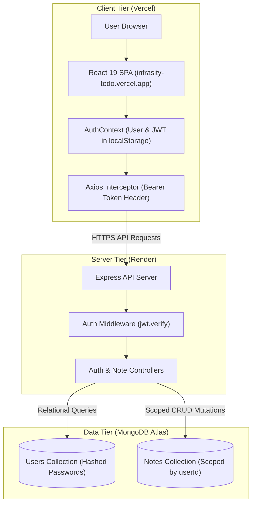

<div align="center">

# 🍷 BurgundyNotes — MERN Note-Taking Application

**A secure, modern, and responsive full-stack note-taking platform built with the MERN stack.**  
*Featuring JWT authentication, strict multi-tenant data isolation, full CRUD operations, and a White & Burgundy design aesthetic.*

<br />

[](https://infrasity-todo.vercel.app/)
[](https://github.com/SanketManav9620/Infrasity_Todo)
[](LICENSE)

<br />


</div>

---

## 📌 Project Submission & Live Links

| Resource | Link |
|---|---|
| **🚀 Live Application (Frontend)** | **[https://infrasity-todo.vercel.app/](https://infrasity-todo.vercel.app/)** |
| **📂 GitHub Source Repository** | **[https://github.com/SanketManav9620/Infrasity_Todo](https://github.com/SanketManav9620/Infrasity_Todo)** |
| **☁️ Backend Hosting** | Render Web Service (`Node.js / Express`) |
| **🗄️ Database Hosting** | MongoDB Atlas (Cloud Cluster M0) |

---

## 🛠️ Tech Stack & Dependencies

### Frontend (`/frontend`)
- **Core Framework:** React 19 & Vite 6
- **Styling:** Tailwind CSS v4 (with custom `@import "tailwindcss";` and Burgundy palette tokens)
- **Icons:** Lucide React (`Pin`, `Search`, `Plus`, `Trash2`, `Edit3`, `LogOut`, etc.)
- **HTTP Client:** Axios (configured with request interceptor for Bearer token & response interceptor for 401 handling)
- **State Management:** React Context API (`AuthContext`) with persistent session re-hydration

### Backend (`/Backend`)
- **Runtime & Framework:** Node.js & Express 4
- **Database ODM:** Mongoose 8 (Schema validation, indexed relational ObjectIds)
- **Security & Authentication:**
  - `bcryptjs` for one-way password hashing (10 salt rounds)
  - `jsonwebtoken` (JWT) for stateless session tokens (7-day validity)
- **Cross-Origin Handling:** CORS middleware configured with permissive origin headers
- **Environment Management:** `dotenv`

---

## 🎨 White & Burgundy Theme Design Specs

The user interface follows a clean, professional, and accessible **White & Burgundy** color scheme:

| Color Role | Hex Code | Preview | Usage |
|---|---|---|---|
| **Background / Canvas** | `#FFFFFF` / `#FAF8F8` | `⚪ White` | App background, card interiors, clean reading surface |
| **Primary Burgundy** | `#800020` | `🍷 Classic Burgundy` | Brand headers, primary buttons, active badges, focus rings |
| **Deep Burgundy** | `#68031C` / `#580B1C` | `🔴 Dark Wine` | Button hover & active states, high-contrast text |
| **Burgundy Tint** | `#FAF0F2` | `🌸 Soft Rose` | Tag backgrounds, user avatar badge, subtle highlights |
| **Border Accent** | `#EBDADF` | `🌫️ Rose Border` | Card outlines, input borders, clean dividers |

---

## 🏗️ Architecture & Data Flow



---

## 🔐 Multi-Tenant Security & Isolation

This application guarantees that **a user can only ever access, edit, or delete their own notes**:

1. **Foreign Key Reference:** Every note document holds a mandatory reference to its creator:
   ```javascript
   user: {
     type: mongoose.Schema.Types.ObjectId,
     ref: 'User',
     required: true,
     index: true
   }
   ```
2. **Query Scoping:** The `getNotes` controller queries notes strictly matching `req.user._id`:
   ```javascript
   const notes = await Note.find({ user: req.user._id });
   ```
3. **Mutation Ownership Check:** For `GET /:id`, `PUT /:id`, and `DELETE /:id`, the controller verifies ownership before any action:
   ```javascript
   if (note.user.toString() !== req.user._id.toString()) {
     return res.status(403).json({ message: 'Access denied: You are not authorized' });
   }
   ```
   *Any attempt by another user to view, edit, or delete the note returns `403 Forbidden`.*

---

## 📡 API Reference

Base URL (Production): `https://<your-render-backend>.onrender.com/api`  
Base URL (Local Development): `http://localhost:5001/api`

### 1. Authentication Endpoints

| Method | Endpoint | Access | Description | Request Payload | Response |
|---|---|---|---|---|---|
| `POST` | `/auth/register` | Public | Create new account | `{ "name": "...", "email": "...", "password": "..." }` | `201 Created` + JWT & user info |
| `POST` | `/auth/login` | Public | Authenticate user | `{ "email": "...", "password": "..." }` | `200 OK` + JWT & user info |
| `GET` | `/auth/me` | Private | Re-verify session token | *Header: `Bearer <token>`* | `200 OK` + current user data |

### 2. Notes Endpoints *(All Private — Requires Bearer Token)*

| Method | Endpoint | Query / Body | Description |
|---|---|---|---|
| `GET` | `/notes` | `?search=...&category=...` | Retrieve all notes for logged-in user (sorted by pinned first) |
| `GET` | `/notes/:id` | None | Get specific note by ID (ownership verified) |
| `POST` | `/notes` | `{ "title": "...", "content": "...", "category": "...", "isPinned": false }` | Create new note linked to user |
| `PUT` | `/notes/:id` | `{ "title": "...", "content": "...", "category": "...", "isPinned": true }` | Update user's note |
| `DELETE` | `/notes/:id` | None | Permanently delete user's note |

### 3. Server Health
| Method | Endpoint | Access | Description |
|---|---|---|---|
| `GET` | `/health` | Public | Returns `{"status":"ok"}` for uptime monitors |

---

## 📂 Project Directory Structure

```
Infrasity/
├── package.json               # Monorepo orchestration scripts
├── .gitignore                 # Excludes .env, node_modules, and build outputs
├── README.md                  # Project documentation & submission details
├── Backend/
│   ├── config/
│   │   └── db.js              # MongoDB Mongoose connection
│   ├── controllers/
│   │   ├── authController.js  # Registration, login, and session validation
│   │   └── noteController.js  # Scoped CRUD note business logic
│   ├── middleware/
│   │   ├── authMiddleware.js  # JWT Bearer token protection middleware
│   │   └── errorMiddleware.js # Centralized 404 & error handlers
│   ├── models/
│   │   ├── User.js            # User model with bcrypt password hashing
│   │   └── Note.js            # Note model referencing User ObjectId
│   ├── routes/
│   │   ├── authRoutes.js      # /api/auth router
│   │   └── noteRoutes.js      # /api/notes router
│   ├── test-api.js            # Automated 14-point backend integration test
│   ├── server.js              # Express app entry & static production server
│   ├── .env.example           # Backend environment template
│   └── package.json           # Backend dependencies
└── frontend/
    ├── src/
    │   ├── api/
    │   │   └── api.js         # Axios instance with request/response interceptors
    │   ├── components/
    │   │   ├── Navbar.jsx     # Header with branding, avatar, & logout
    │   │   ├── NoteCard.jsx   # Note card with category tags & pin action
    │   │   ├── NoteModal.jsx  # Create & edit modal
    │   │   └── DeleteConfirmModal.jsx # Deletion confirmation dialog
    │   ├── context/
    │   │   └── AuthContext.jsx# React Context for global auth state
    │   ├── pages/
    │   │   ├── Dashboard.jsx  # Notes grid, search bar, & category filters
    │   │   ├── Login.jsx      # Clean sign-in form
    │   │   └── Register.jsx   # Account creation form
    │   ├── App.jsx            # App view router
    │   ├── index.css          # Tailwind CSS v4 directives & custom scrollbars
    │   └── main.jsx           # React DOM root render
    ├── index.html
    ├── vite.config.js         # Vite config with reverse-proxy
    ├── vercel.json            # Vercel SPA URL rewrites configuration
    ├── .env.example           # Frontend environment template
    └── package.json           # Frontend dependencies
```

---

## 💻 Local Setup & Development

### 1. Clone the Repository
```bash
git clone https://github.com/SanketManav9620/Infrasity_Todo.git
cd Infrasity_Todo
```

### 2. Configure Environment Variables
Create a `.env` file in the `Backend` directory:
```env
PORT=5001
MONGODB_URI=mongodb://127.0.0.1:27017/notetaking_app
JWT_SECRET=burgundy_secure_jwt_secret_key_2026_note_taking_app
NODE_ENV=development
```
*(If using MongoDB Atlas, replace `MONGODB_URI` with your Atlas connection string).*

### 3. Install Dependencies
```bash
# Backend dependencies
cd Backend && npm install

# Frontend dependencies
cd ../frontend && npm install
cd ..
```

### 4. Run Development Servers
- **Terminal 1 (Backend API):**
  ```bash
  cd Backend
  npm run dev
  ```
  *Server runs at `http://localhost:5001`*

- **Terminal 2 (Frontend Client):**
  ```bash
  cd frontend
  npm run dev
  ```
  *Client runs at `http://localhost:3000` (requests to `/api` are automatically proxied to port 5001)*

---

## 🧪 Automated Verification Suite

A 14-point automated test script verifies all security boundaries and CRUD operations:
```bash
npm run test:backend
```

**Test Output (14 / 14 Passed):**
```text
--- 🧪 Starting Note-Taking API Automated Verification ---
[Test 1] Health check: Status 200 (Expected 200)
[Test 2] Unauthenticated access to /api/notes: Status 401 (Expected 401)
[Test 3] Register User A: Status 201 (Expected 201)
[Test 4] Reject duplicate registration: Status 400 (Expected 400)
[Test 5] Login User A: Status 200 (Expected 200)
[Test 6] Register User B: Status 201 (Expected 201)
[Test 7] Create Note by User A: Status 201 (Expected 201)
[Test 8] User A fetch notes count: 1 (Expected >= 1)
[Test 9] User B notes list isolation check: count = 0 (Expected 0)
[Test 10] User B unauthorized note access by ID: Status 403 (Expected 403)
[Test 11] User B unauthorized note update: Status 403 (Expected 403)
[Test 12] User B unauthorized note delete: Status 403 (Expected 403)
[Test 13] User A update note: Status 200 (Expected 200)
[Test 14] User A delete note: Status 200 (Expected 200)

✅ ALL 14 BACKEND TESTS PASSED! Authentication & User Isolation are 100% Verified.
```

---

## 🌐 Live Deployment Architecture

The application is deployed across modern cloud providers:

1. **Frontend (Vercel):**
   - **Live URL:** [https://infrasity-todo.vercel.app/](https://infrasity-todo.vercel.app/)
   - Root directory set to `frontend` with automatic Vite framework detection.
   - `vercel.json` provides SPA routing rewrites so refreshing any page route works seamlessly.
   - Environment variable `VITE_API_URL` points directly to the hosted backend API.

2. **Backend (Render):**
   - Node.js Web Service with root directory set to `Backend`.
   - Build Command: `npm install` | Start Command: `node server.js`.
   - Connected to MongoDB Atlas cluster for data persistence.

3. **Database (MongoDB Atlas):**
   - Secure cloud MongoDB cluster with IP access whitelist (`0.0.0.0/0`) and dedicated user authentication.

---

## 📄 License

This project is licensed under the [MIT License](LICENSE).
